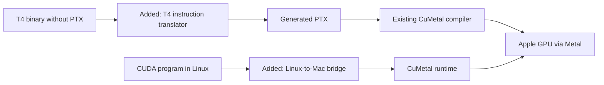

# CUDA on Metal Lab

I want to run existing CUDA training software on Apple silicon without porting each library to Metal by hand. This repository contains my experiments on top of [CuMetal](https://github.com/Lulzx/cuda-metal/tree/912694289d5751ff529db94016388744084873b4). CuMetal already translates supported PTX, an intermediate language for GPU programs, into code that runs through Metal. I added a way to feed it certain NVIDIA T4 binaries that ship without PTX, a bridge for requests from Linux, and fixes to the existing compiler and runtime.

## A binary that used to stop at launch

I started with NVIDIA's `vectorAdd` sample compiled for a Tesla T4. The prepared CuMetal build I was testing failed to launch that file. With my loader enabled, **the same binary ran on an Apple M2**. The loader uses NVIDIA's `nvdisasm` to decode the T4 instructions, translates the supported instructions into new PTX, and passes that PTX to CuMetal's existing backend. The original CUDA source is unnecessary at run time.

To check what the translator was actually reading, I changed two bytes in one instruction, turning addition into multiplication. I left the kernel name as `vectorAdd`. The M2 produced products instead of sums. Across four small binaries and 36 test cases, all 207,472 checked output values matched a physical T4 on Colab. An atomic-add example hit an unsupported instruction and stopped before dispatch. I repeated the M2 checks with the source packaged here and the saved T4 outputs. [Translator](sass/lifter/lift.py) · [Loader patch](sass/mac/driver.patch) · [Original comparison](sass/verified/comparison.json) · [Packaged source results](sass/verified/packaged-replay.json)

## What I added

| Component | Contribution | Where to start |
| --- | --- | --- |
| T4 binary loading | Load standalone Turing `sm_75` CUDA binaries from a file or memory and translate a small subset of their machine instructions (SASS). | [Reproduce the T4 experiment](sass/README.md) |
| Linux bridge | Forward selected driver calls from a Linux ARM64 process to CuMetal on macOS. NVIDIA's original runtime allocated and copied the data; the test program then launched a GPU kernel and read back `[5, 7, 9]`. | [Guest driver and Mac host](bridge/README.md) |
| NVRTC compilation | Match an exact binary to PTX emitted by the same NVIDIA compiler invocation. A changed binary is rejected. | [Companion matching code and test](nvrtc/README.md) |
| PTX and runtime fixes | Determine what an individual kernel and its callees need. An unrelated function in the same module had prevented Softmax from running. I also fixed how existing math helpers were supplied to translated Attention code and tested 24 selected upstream Warp cases. | [Compiler changes and evidence](compiler/README.md) |
| Repeated GPU launches | Cache the amount of shared memory a compiled kernel needs, so repeated launches can reuse that information. The paired benchmark includes both queued and individually synchronized launches. | [Runtime change and timings](launch/README.md) |

These are separate research experiments. Each component documents the version and environment it uses. The T4 translator currently handles a small set of arithmetic and memory instructions. Running a whole CUDA library also requires support for the driver calls and GPU instructions that the library actually uses.

## Training and performance

In a separate **source-based** experiment, I ran three updates of GPT-2 124M using the original FP32 training code from [llm.c](https://github.com/karpathy/llm.c/blob/f1e2ace651495b74ae22d45d1723443fd00ecd3a/train_gpt2_fp32.cu). With the same training input, the median time after the first step was **326 ms on M2 and 56 ms on T4**. The final validation losses were 3.7411 and 3.7415. This was a short run: three runs on the Mac, one on Colab. [Step timings and settings](evidence/gpt2-training.json)

I also measured GPT-2's output projection on the **same M2** using identical FP32 inputs for both implementations. The translated training kernel took **24.10 ms**, and Apple's matrix implementation took **12.45 ms**. All 6,438,912 output values agreed within the stated tolerance. This benchmark measures one operation; automatic selection of the faster implementation is future work. [Benchmark and raw samples](benchmarks/matmul/README.md)

## Where I'm taking this

I plan to keep working on the compatibility layer. My next steps are to:

1. Add support for the atomic instruction that stopped the T4 test. Check contention and memory behavior against a real NVIDIA GPU before enabling it.
2. Teach the compiler to recognize matrix operations it can safely run through a faster Metal implementation. Verify the outputs and remeasure the full training step.
3. Run a small existing post-training project end to end and use its first unsupported call or instruction to guide the next general fix.

The repository includes third-party components, licenses and attribution. [Source credits](THIRD_PARTY.md)
